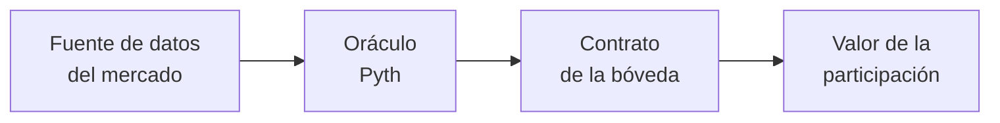

# PoC-Oraculo-Pyth — Bóveda tokenizada con precio bursátil vía oráculo

> **En una frase:** queremos probar cómo traer a blockchain el precio real de una acción mediante un
> oráculo y usar ese dato para actualizar el valor de una bóveda tokenizada. Después evaluaremos qué
> hacer cuando la bolsa está cerrada y no hay un precio nuevo.

## Contexto

### Historia de usuario

Como **equipo de Arquitectura e Innovación**, queremos probar cómo un oráculo obtiene el precio de un
activo negociado en el mercado tradicional y lo suministra a una bóveda tokenizada, con el fin de
actualizar el valor de sus participaciones y analizar su comportamiento cuando el mercado está
abierto o cerrado.

### ¿Por qué un oráculo?

El precio de una acción vive fuera de blockchain (bolsas, proveedores de datos de mercado). Un
contrato inteligente no puede consultar una página financiera ni una plataforma de negociación;
necesita que un **oráculo** traiga ese dato a la cadena de forma verificable.



1. Una fuente externa publica el precio del activo.
2. El oráculo obtiene y valida esa información.
3. El oráculo lleva el dato a blockchain.
4. La bóveda consulta el precio.
5. La bóveda calcula el valor de cada participación.

### Ejemplo

| Situación              | Precio acción | Acciones en la bóveda | Valor bóveda | Participaciones | Valor por participación |
|------------------------|---------------|-----------------------|--------------|-----------------|-------------------------|
| Inicial                | USD 100       | 10                    | USD 1.000    | 100             | **USD 10**              |
| El precio sube         | USD 110       | 10                    | USD 1.100    | 100             | **USD 11**              |

### Alcance

La PoC debe:

- Identificar y validar un oráculo que entregue el precio de un activo bursátil, con su **fuente**,
  **fecha de actualización** y **estado del mercado**.
- Demostrar cómo la bóveda usa ese precio para calcular el valor de sus participaciones.
- Evaluar qué ocurre cuando el mercado está cerrado y el oráculo mantiene el último precio:
  suspender operaciones, dejar solicitudes pendientes o aplicar controles sobre precios desactualizados.
- Analizar si **ERC-7540** (bóvedas asíncronas) conviene para depósitos y redenciones que no pueden
  procesarse de inmediato.

## Estado de los criterios de aceptación

| CA  | Criterio                  | Estado | Evidencia |
|-----|---------------------------|--------|-----------|
| CA1 | Selección del activo      | ✅ Hecho | Activo: **AAPL**. Oráculo: **Pyth**, feed `Equity.US.AAPL/USD`. Ver [docs/oraculos.md](docs/oraculos.md) |
| CA2 | Consulta del precio       | 🟡 Parcial | Fecha y estado del mercado consultados. El precio firmado de AAPL requiere un plan de Pyth con acceso a acciones (hoy responde 403); el flujo completo se validó con ETH/USD. `script/fetch-price.mjs`, `script/onchain-check.mjs` |
| CA3 | Integración con la bóveda | ✅ Validado | `TokenizedStockVault` (ERC-4626) calcula `totalAssets = acciones × precio`. Tests `test_DepositBuysUnitsAtOraclePrice`, `test_LateDepositorGetsFewerShares`, `test_RedeemAfterGain` |
| CA4 | Actualización del valor   | ✅ Validado | Test `test_SharePriceFollowsOracle`: el precio pasa de 200 a 220 y la participación de 1,00 a 1,10 |
| CA5 | Precio desactualizado     | ✅ Validado | `OracleAdapter` marca `Stale` si se supera `maxAge` y la bóveda bloquea las operaciones (`test_StalePriceBlocksEverything`, `test_OracleDownBlocksAndNavReportsIt`). Caso real: precio on-chain de ETH con 27 días y 12,6 % de desvío |
| CA6 | Mercado cerrado           | ✅ Validado | Estado `MarketClosed` y política configurable para depósitos y redenciones (`test_WeekendBlocksByDefault`, `test_WeekendWithdrawalsAllowedByPolicy`, `test_HolidayForcedClosed`) |
| CA7 | Evaluación de alternativas| ⬜ Pendiente | Hoy se cubren *rechazar* y *atender con el último precio*. Falta *solicitudes pendientes* (ERC-7540) |
| CA8 | Recomendación final       | ⬜ Pendiente | Se redacta al cerrar CA2 y CA7 |

## Cómo está construida la PoC

```
src/oracle/IPyth.sol               Interfaz mínima de Pyth (ABI compatible con el contrato real)
src/oracle/OracleAdapter.sol       Normaliza el precio a 18 decimales y clasifica su estado
src/vault/TokenizedStockVault.sol  Bóveda ERC-4626 (modelo respaldado) valorizada con el oráculo
test/mocks/                        MockPyth (precio, fecha, caída del oráculo) y MockUSDC
test/*.t.sol                       Escenarios: abierto, fin de semana, feriado, vencido, caído
script/fetch-price.mjs             Consulta off-chain del feed en Hermes (Pyth)
script/onchain-check.mjs           Lectura on-chain, tarifa y simulación de actualización en Base Sepolia
script/Deploy.s.sol                Despliegue de la demo (bóveda ETH con Pyth real + bóveda AAPL simulada)
script/start-chain.sh              Levanta la blockchain local y despliega la demo
app/                               Demo web con MetaMask (index.html, app.js) y servidor proxy (server.mjs)
docs/oraculos.md                   Comparativa de oráculos y evidencia recolectada
```

### Estados del precio (`OracleAdapter.PriceStatus`)

| Estado         | Condición                                                    | Bóveda (por defecto)       |
|----------------|--------------------------------------------------------------|----------------------------|
| `Fresh`        | Mercado abierto y `edad <= maxAge`                           | Depósitos y retiros        |
| `MarketClosed` | Mercado cerrado y `edad <= maxClosedAge` (precio congelado)  | Bloqueado (configurable)   |
| `Stale`        | Edad mayor al límite correspondiente                         | Bloqueado                  |
| `Invalid`      | Precio <= 0 o `conf/precio > maxConfBps`                     | Bloqueado                  |
| `Unavailable`  | El oráculo revierte o el feed no existe                      | Bloqueado, `nav()` informa |

La política fuera de horario se cambia con `setClosedMarketPolicy(depositos, retiros)`.

## Requisitos

1. **Foundry**: `curl -L https://foundry.paradigm.xyz | bash` y luego `foundryup`.
   En Windows se recomienda WSL; ahí el repo está en `/mnt/c/Users/<usuario>/Documents/Banco/PoC-Oraculo-Pyth`.
2. **Node 20+** para los scripts.
3. **API key de Pyth** (https://pythdata.app/signup) en un archivo `.env`, que está excluido de git:
   ```
   PYTH_API_KEY=...
   ```

## Uso

```bash
git submodule update --init --recursive   # forge-std v1.9.4, OpenZeppelin v5.1.0
forge build
forge test -vv

node --env-file=.env script/fetch-price.mjs AAPL           # metadatos, estado del mercado y precio
node --env-file=.env script/fetch-price.mjs ETH crypto     # cripto (incluido en el plan de prueba)
node --env-file=.env script/onchain-check.mjs ETH crypto   # on-chain, tarifa y simulación en Base Sepolia
```

## Demo web con MetaMask

Una página web conectada a MetaMask donde se opera la bóveda como en un producto real. Corre sobre
una **copia local de Base Sepolia** (Anvil), que incluye el **contrato real de Pyth**, sin necesidad de
ETH de faucet.

| Bóveda | Oráculo | Para qué sirve |
|--------|---------|----------------|
| **ETH** | Contrato **real** de Pyth, feed `Crypto.ETH/USD`, precio firmado desde Hermes | Demostrar la integración real con el oráculo |
| **AAPL** | `MockPyth` controlado desde la página, horario NYSE | Provocar cada escenario: subir el precio, cerrar el mercado, dejar vencer el precio, caída del oráculo |

### Arranque (dos terminales)

```bash
# Terminal 1 (WSL): blockchain local + despliegue. Ctrl+C la detiene.
cd /mnt/c/Users/<usuario>/Documents/Banco/PoC-Oraculo-Pyth
./script/start-chain.sh

# Terminal 2 (Windows o WSL): servidor web, que guarda la API key de Pyth
node --env-file=.env app/server.mjs
```

Abre **http://localhost:3000**.

### Configurar MetaMask (una sola vez)

1. Instala MetaMask y crea o abre una wallet. Las cuentas que se importan aquí **solo sirven en local**.
2. Pulsa **Conectar MetaMask**: la página agrega la red "PoC Local (Anvil)" (chain id 31337).
3. Importa estas cuentas de prueba de Anvil (*Importar cuenta → clave privada*). Son públicas y
   **nunca deben usarse en redes reales**:
   - **Administrador** (controles de escenario): `0xac0974bec39a17e36ba4a6b4d238ff944bacb478cbed5efcae784d7bf4f2ff80`
   - **Inversionista**: `0x59c6995e998f97a5a0044966f0945389dc9e86dae88c7a8412f4603b6b78690d`

   Ambas reciben 10.000 mUSDC al desplegar.
4. Cada vez que reinicies `start-chain.sh`, en MetaMask ve a *Configuración → Avanzado →
   Borrar datos de actividad*, para evitar errores de *nonce*.

### Guion de la demo

| # | Acción en la página | Resultado esperado | CA |
|---|---------------------|--------------------|----|
| 1 | Abrir la Bóveda ETH | 🔴 **Precio vencido**: el precio guardado on-chain tiene semanas de antigüedad | CA5 |
| 2 | Depositar 100 mUSDC | Rechazado: *Operación rechazada por la bóveda: Precio vencido* | CA5 |
| 3 | **Actualizar precio desde Pyth** | 🟢 **Precio vigente**, con precio real y fecha de hace segundos | CA2 |
| 4 | Depositar 100 mUSDC | Se emiten participaciones; el respaldo se muestra en ETH | CA3 |
| 5 | Esperar 2 minutos sin actualizar | Vuelve a 🔴 **Precio vencido** y las operaciones se bloquean | CA5 |
| 6 | Bóveda AAPL fuera del horario NYSE | 🟡 **Mercado cerrado · precio congelado**; depósito rechazado | CA6 |
| 7 | Activar *Retiros en cierre* | Con el mercado cerrado se permiten retiros, pero no depósitos | CA6, CA7 |
| 8 | *Simular mercado abierto* → depositar → publicar precio 247,5 (+10 %) | La participación pasa de 1,00 a 1,10 | CA4 |
| 9 | *Liquidar custodio* → redimir | Se retira con la ganancia | CA3 |
| 10 | *Simular oráculo caído* | 🔴 **Oráculo sin respuesta**; NAV no disponible y operaciones rechazadas | CA5 |

## Próximos pasos

- [x] Ejecutar `forge test`: 20/20 tests pasan (forge 1.8.7, 2026-10-29).
- [x] Demo web con MetaMask sobre una copia local de Base Sepolia con el contrato real de Pyth.
- [ ] Obtener acceso a feeds de acciones en Pyth y validar el precio real de AAPL (CA2).
- [ ] Bóveda asíncrona ERC-7540: `requestDeposit` y `requestRedeem` liquidados con un precio `Fresh` (CA7).
- [ ] Completar la comparativa con Chainlink Data Streams y RedStone (CA1, CA8).
- [ ] Documentar el modelo sintético frente al respaldado y redactar la recomendación (CA8).
